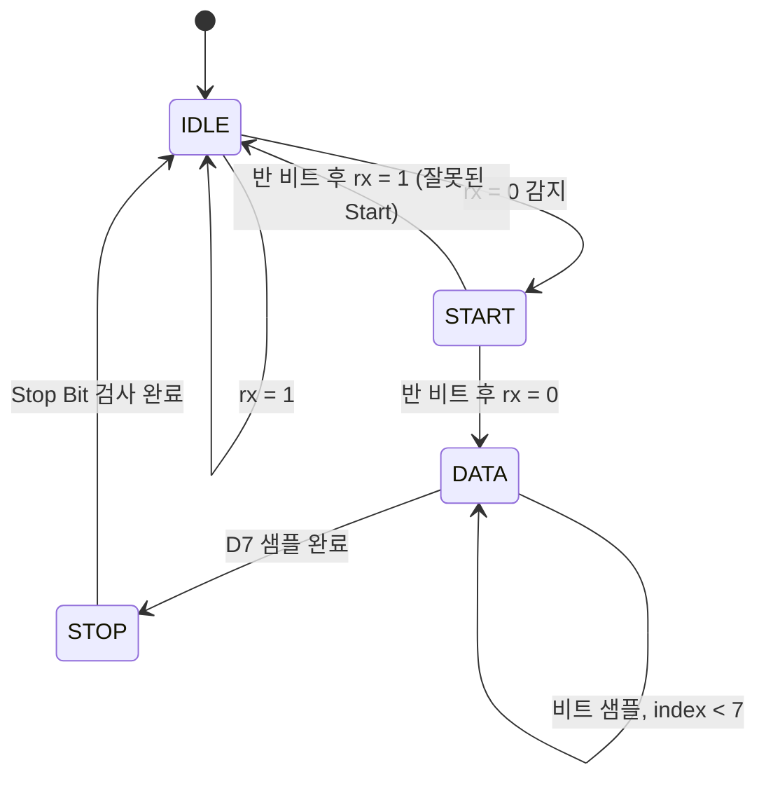

# Week 02 · Day 10 — FSM 기초와 UART RX 상태도

> **학습 주제:** FSM(Finite State Machine)과 UART 8N1 수신기 상태 설계  
> **오늘의 목표:** UART 수신 과정을 `IDLE → START → DATA → STOP` 상태로 구분하고, 각 상태의 동작과 전이 조건을 설명한다.  
> **진행 상태:** 학습 및 실습 결과 확인 전. 완료 항목은 실제 수행 후 체크한다.

## 1. 오늘의 체크리스트

- [ ] FSM의 현재 상태, 다음 상태, 상태 전이 개념 이해
- [ ] Moore FSM과 Mealy FSM 차이 이해
- [ ] Verilog `localparam`과 SystemVerilog `typedef enum` 비교
- [ ] `always_ff`와 `always_comb`의 역할 구분
- [ ] UART 8N1 프레임과 LSB-first 전송 순서 이해
- [ ] UART RX 4개 상태의 상태도 및 상태전이표 작성
- [ ] Baud Rate 카운터와 비트 중앙 샘플링 개념 이해
- [ ] (선택) FSM 상태 전이 RTL/TB 작성 및 시뮬레이션
- [ ] 실제 학습 결과·오류·개선 사항 기록

**완료 기준:** 상태도와 상태전이표를 작성하고, 정상 Start Bit와 잘못된 Start Bit의 전이 조건을 설명할 수 있다. 실제 8비트 UART 수신기 구현은 Day11에 진행한다.

## 2. 학습 자료

- [신경욱 교수 KOCW HDL 설계](https://www.kocw.net/home/search/kemView.do?kemId=1428200) — 순차회로 모델링 관련 내용 복습
- **『디지털 논리설계와 컴퓨터 구조 RISC-V Edition』(홍릉)** — **3.4 유한 상태 머신(FSM 개념·상태도·Moore/Mealy)**, **4.6 유한 상태 기계(HDL 구현)**를 필수 학습. 3.3 동기식 논리 설계 복습, 3.5 순차 논리의 타이밍은 심화 학습.
- [Day07: DFF 및 할당 방식](../Day07/README.md)
- [Day08: 리셋과 카운터](../Day08/README.md)
- [Day09: 8비트 시프트 레지스터](../Day09/README.md)

Day07~09에서 공부한 **DFF(상태 저장)**, **카운터(시간 측정)**, **시프트 레지스터(데이터 저장)**를 UART RX의 제어 구조에 연결한다.

## 3. 핵심 개념

### 3.1 FSM(Finite State Machine)

FSM은 현재 상태와 입력 조건에 따라 다음 상태를 결정하는 순차논리회로다.

| 개념 | 설명 |
|---|---|
| `state` | 현재 상태를 저장하는 레지스터 |
| `next_state` | 현재 상태와 입력을 바탕으로 계산한 다음 상태 |
| State Transition | 클록 에지에서 상태가 변경되는 동작 |
| Moore FSM | 출력이 현재 상태에만 의존 |
| Mealy FSM | 출력이 현재 상태와 입력에 의존 |

일반적인 **2-process FSM**은 상태 저장과 다음 상태 계산을 분리한다.

- **상태 저장:** `always_ff @(posedge clk or negedge rst_n)`, Nonblocking(`<=`)
- **다음 상태 계산:** `always_comb`, Blocking(`=`)
- **기본값:** `next_state = state;`로 조건이 없을 때 상태 유지, 불완전한 조합논리 할당 방지

### 3.2 UART 8N1 프레임

- **8:** 데이터 8비트
- **N:** 패리티 비트 없음
- **1:** Stop Bit 1비트
- 대기 시 `rx=1`, Start Bit는 `0`, Stop Bit는 `1`
- 데이터는 **LSB(D0)부터 MSB(D7)** 순서로 전송

```text
IDLE(1) | START(0) | D0 | D1 | D2 | D3 | D4 | D5 | D6 | D7 | STOP(1) | IDLE(1)
```

UART는 송수신 클록이 별도로 연결되지 않으므로, 수신기는 Start Bit를 감지한 뒤 **비트 중앙**에서 데이터를 샘플링한다.

### 3.3 Baud Rate와 카운터

예를 들어 FPGA 클록이 100 MHz이고 Baud Rate가 115200이라면:

```text
CLKS_PER_BIT = 100,000,000 / 115,200 ≈ 868.06 clocks
HALF_BIT    ≈ 434 clocks
```

Start Bit 감지 후 약 반 비트 뒤에 Start Bit가 여전히 0인지 확인하고, 이후 약 한 비트 간격으로 D0~D7과 Stop Bit를 샘플링한다. 실제 RTL에서는 정수 분주 오차와 카운터의 `N-1` 조건을 고려해야 한다.

## 4. UART RX 상태도 및 상태전이표

### 4.1 상태도



### 4.2 상태전이표

| 현재 상태 | 주요 동작 | 전이 조건 | 다음 상태 |
|---|---|---|---|
| IDLE | 수신 대기 및 카운터 초기화 | `rx=1` | IDLE |
| IDLE | Start Bit 시작 감지 | `rx=0` | START |
| START | Start Bit 중앙까지 대기 | 반 비트 경과, `rx=0` | DATA |
| START | 잘못된 시작 신호 판정 | 반 비트 경과, `rx=1` | IDLE |
| DATA | D0~D7을 순서대로 샘플링 | `bit_index < 7` | DATA |
| DATA | 마지막 비트 D7 샘플링 | D7 샘플 완료 | STOP |
| STOP | Stop Bit 검사 | 검사 완료 | IDLE |

**참고:** STOP 상태에서 `rx=0`이면 Framing Error로 처리할 수 있다. 정상 수신 완료 신호는 유효한 Stop Bit를 확인한 경우에만 발생시키는 방식으로 Day11에서 설계한다.

## 5. SystemVerilog FSM 실습

### 5.1 학습용 상태 전이 코드

다음 코드는 **상태 전이 로직만 발췌한 예시**다. `rx_sync`, `half_bit_done`, `bit_done`, `bit_index`는 아직 구현되지 않은 동기화 입력·타이머·카운터 신호이며, 이 코드만으로 UART 수신기가 완성되지는 않는다.

```systemverilog
typedef enum logic [1:0] {
    IDLE,
    START,
    DATA,
    STOP
} state_t;

state_t state, next_state;

always_ff @(posedge clk or negedge rst_n) begin
    if (!rst_n)
        state <= IDLE;
    else
        state <= next_state;
end

always_comb begin
    next_state = state;

    case (state)
        IDLE: begin
            if (!rx_sync)
                next_state = START;
        end

        START: begin
            if (half_bit_done)
                next_state = rx_sync ? IDLE : DATA;
        end

        DATA: begin
            if (bit_done && bit_index == 3'd7)
                next_state = STOP;
        end

        STOP: begin
            if (bit_done)
                next_state = IDLE;
        end

        default: next_state = IDLE;
    endcase
end
```

### 5.2 Verilog와 SystemVerilog 비교

| Verilog | SystemVerilog |
|---|---|
| `localparam IDLE = 2'b00;` | `typedef enum logic [1:0] {IDLE, ...} state_t;` |
| `reg [1:0] state;` | `state_t state;` |
| `always @(posedge clk ...)` | `always_ff @(posedge clk ...)` |
| `always @(*)` | `always_comb` |

**직접 해볼 실습**

1. 위 상태 전이 코드를 참고하여 상태도와 전이표를 먼저 손으로 작성한다.
2. (선택) `rtl/uart_rx_fsm.sv`에서 상태 전이만 구현한다.
3. (선택) `tb/tb_uart_rx_fsm.sv`에서 정상 Start와 잘못된 Start 조건을 입력한다.
4. (선택) Vivado에서 `state`, `next_state` 파형을 확인한다.

오늘은 SystemVerilog 중심으로 학습하고, Python은 별도 실습 없이 넘어간다. C는 ARM 소프트웨어 단계에서 진행한다.

## 6. 검증 결과

| 검증 항목 | 기대 결과 | 실제 결과 |
|---|---|---|
| UART 8N1 프레임 | Start 1비트, Data 8비트, Stop 1비트 | 미확인 |
| FSM 상태도 | 4개 상태 및 전이 조건 정리 | 미확인 |
| 상태전이표 | 정상·비정상 Start 구분 | 미확인 |
| FSM 시뮬레이션 (선택) | 정상 상태 순환, 잘못된 Start 복귀 | 미실행 |
| Vivado 파형 (선택) | 상태와 전이 조건 일치 | 미첨부 |

**파형/상태도 이미지:** 실습 후 추가  
**PASS/FAIL 로그:** 실습 후 추가

## 7. 에러 및 해결

- **발생한 문제:** 실습 후 작성
- **원인:** 실습 후 작성
- **수정한 RTL/SV/TB 코드:** 실습 후 작성
- **변경 전후 결과:** 실습 후 작성

## 8. 학습 내용 및 느낀 점

- **새롭게 이해한 개념:** 실습 후 작성
- **기존에 잘못 알고 있던 부분:** 실습 후 작성
- **추가로 공부할 내용:**
  - Baud Rate 카운터 및 비트 중앙 샘플링
  - 8비트 수신 데이터 저장
  - `rx_done` 펄스 및 Stop Bit 오류 검출
  - 비동기 `rx` 입력의 2단 동기화

## 9. 다음 학습 — Day11

[Day11: UART RX 8N1 RTL 구현](../Day11/README.md)

Day10의 FSM을 바탕으로 Baud Rate 카운터, 데이터 저장 레지스터, Stop Bit 검사, `rx_done` 신호를 연결하여 실제 UART 수신기를 구현한다.

> 완료 체크와 검증 결과는 **실제 작성·시뮬레이션한 후에만** 갱신한다.
