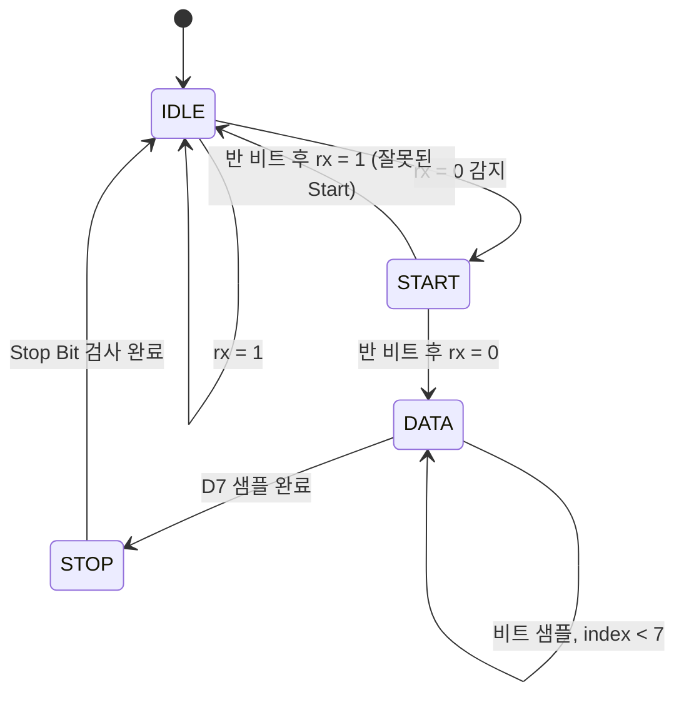

# Week 02 · Day 10 — FSM 기초와 UART RX 상태도

> **학습 주제:** FSM(Finite State Machine)과 UART 8N1 수신기 상태 설계  
> **오늘의 목표:** UART 수신 과정을 `IDLE → START → DATA → STOP` 상태로 구분하고, 각 상태의 동작과 전이 조건을 설명한다.  
> **진행 상태:** 학습 및 실습 결과 확인 전. 완료 항목은 실제 수행 후 체크한다.

## 1. 오늘의 체크리스트

- [ ] FSM의 현재 상태, 다음 상태, 상태 전이 개념 이해
- [ ] Moore FSM과 Mealy FSM 차이 이해
- [ ] Verilog `localparam`과 SystemVerilog `typedef enum` 비교
- [ ] `always_ff`와 `always_comb`의 역할 구분
- [ ] UART 8N1 프레임과 LSB-first 전송 순서 이해
- [ ] UART RX 4개 상태의 상태도 및 상태전이표 작성
- [ ] Baud Rate 카운터와 비트 중앙 샘플링 개념 이해
- [ ] FSM 상태 부호화(Binary/One-Hot/One-Cold)와 Area·Timing Trade-off 이해
- [ ] 교통 신호등 FSM의 S1/S3 5클록 대기 카운터 원리 이해
- [ ] (선택) 교통 신호등 FSM 5클록 대기 TB/파형 검증
- [ ] (선택) FSM 상태 전이 RTL/TB 작성 및 시뮬레이션
- [ ] 실제 학습 결과·오류·개선 사항 기록

**완료 기준:** 상태도와 상태전이표를 작성하고, 정상 Start Bit와 잘못된 Start Bit의 전이 조건을 설명할 수 있다. 실제 8비트 UART 수신기 구현은 Day11에 진행한다.

## 2. 학습 자료

- [신경욱 교수 KOCW HDL 설계](https://www.kocw.net/home/search/kemView.do?kemId=1428200) — 순차회로 모델링 관련 내용 복습
- **『디지털 논리설계와 컴퓨터 구조 RISC-V Edition』(홍릉)** — **3.4 유한 상태 머신(FSM 개념·상태도·Moore/Mealy)**, **4.6 유한 상태 기계(HDL 구현)**를 필수 학습. 3.3 동기식 논리 설계 복습, 3.5 순차 논리의 타이밍은 심화 학습.
- [Day07: DFF 및 할당 방식](../Day07/README.md)
- [Day08: 리셋과 카운터](../Day08/README.md)
- [Day09: 8비트 시프트 레지스터](../Day09/README.md)

Day07~09에서 공부한 **DFF(상태 저장)**, **카운터(시간 측정)**, **시프트 레지스터(데이터 저장)**를 UART RX의 제어 구조에 연결한다.

## 3. 핵심 개념

### 3.1 FSM(Finite State Machine)

FSM은 현재 상태와 입력 조건에 따라 다음 상태를 결정하는 순차논리회로다.

| 개념 | 설명 |
|---|---|
| `state` | 현재 상태를 저장하는 레지스터 |
| `next_state` | 현재 상태와 입력을 바탕으로 계산한 다음 상태 |
| State Transition | 클록 에지에서 상태가 변경되는 동작 |
| Moore FSM | 출력이 현재 상태에만 의존 |
| Mealy FSM | 출력이 현재 상태와 입력에 의존 |

일반적인 **2-process FSM**은 상태 저장과 다음 상태 계산을 분리한다.

- **상태 저장:** `always_ff @(posedge clk or negedge rst_n)`, Nonblocking(`<=`)
- **다음 상태 계산:** `always_comb`, Blocking(`=`)
- **기본값:** `next_state = state;`로 조건이 없을 때 상태 유지, 불완전한 조합논리 할당 방지

### 3.2 UART 8N1 프레임

- **8:** 데이터 8비트
- **N:** 패리티 비트 없음
- **1:** Stop Bit 1비트
- 대기 시 `rx=1`, Start Bit는 `0`, Stop Bit는 `1`
- 데이터는 **LSB(D0)부터 MSB(D7)** 순서로 전송

```text
IDLE(1) | START(0) | D0 | D1 | D2 | D3 | D4 | D5 | D6 | D7 | STOP(1) | IDLE(1)
```

UART는 송수신 클록이 별도로 연결되지 않으므로, 수신기는 Start Bit를 감지한 뒤 **비트 중앙**에서 데이터를 샘플링한다.

### 3.3 Baud Rate와 카운터

예를 들어 FPGA 클록이 100 MHz이고 Baud Rate가 115200이라면:

```text
CLKS_PER_BIT = 100,000,000 / 115,200 ≈ 868.06 clocks
HALF_BIT    ≈ 434 clocks
```

Start Bit 감지 후 약 반 비트 뒤에 Start Bit가 여전히 0인지 확인하고, 이후 약 한 비트 간격으로 D0~D7과 Stop Bit를 샘플링한다. 실제 RTL에서는 정수 분주 오차와 카운터의 `N-1` 조건을 고려해야 한다.


### 3.4 Moore FSM과 Mealy FSM — 교통 신호등 예제

- **Moore FSM:** 출력은 현재 상태에만 의존한다. \`output = f(state)\`
- **Mealy FSM:** 출력은 현재 상태와 입력에 의존한다. \`output = f(state, input)\`
- **주의:** *다음 상태*는 Moore와 Mealy 모두 현재 상태 및 입력에 따라 결정될 수 있다. 구분 기준은 **출력의 결정 조건**이다.

교통 신호등 예제에서 \`S0\`은 A도로 초록불, B도로 빨간불이다. \`ta=0\`이 되면 \`next_state=S1\`을 계산하지만, **Moore 방식에서는 다음 클록 에지에 \`state\`가 S1로 바뀐 후** 노란불을 출력한다. 반면 Mealy 방식으로 S0의 출력 자체를 \`ta\`에 의존하도록 만들면, 상태가 S0인 동안에도 입력 변화에 따라 출력이 변할 수 있다.

| 상태 | A도로(\`la\`) | B도로(\`lb\`) | 다음 상태 조건 |
|---|---|---|---|
| S0 | GREEN | RED | \`ta=1\`: S0 유지 / \`ta=0\`: S1 |
| S1 | YELLOW | RED | S2 |
| S2 | RED | GREEN | \`tb=1\`: S2 유지 / \`tb=0\`: S3 |
| S3 | RED | YELLOW | S0 |

Mealy 출력은 입력 변화에 더 빨리 반응할 수 있지만, 비동기 입력이나 글리치가 출력에 직접 영향을 줄 수 있으므로 실제 회로에서는 동기화와 출력 안정성을 고려해야 한다.

### 3.5 FSM 상태 부호화 — Binary / One-Hot / One-Cold

FSM의 **상태 부호화(State Encoding)**는 상태 레지스터에 어떤 비트 패턴을 저장할지 정하는 방법이다. 기능은 같아도 합성 후 FF 개수, 상태 디코딩 논리, 타이밍 및 전력이 달라질 수 있다.

| 상태 | Binary (2비트) | One-Hot (4비트) | One-Cold (4비트) |
|---|---|---|---|
| S0 | \`00\` | \`0001\` | \`1110\` |
| S1 | \`01\` | \`0010\` | \`1101\` |
| S2 | \`10\` | \`0100\` | \`1011\` |
| S3 | \`11\` | \`1000\` | \`0111\` |

- **Binary:** N개 상태를 표현하는 데 최소 \`ceil(log2(N))\`개의 FF를 사용한다. FF 면적에는 유리하지만 상태 디코딩 논리가 더 복잡해질 수 있다.
- **One-Hot:** N개 상태에 N개의 FF를 사용하고, 유효한 상태에서는 딱 한 비트만 1이다. 상태 판별과 다음 상태 논리가 단순해져 **타이밍에 유리할 수 있지만**, FF 및 클록 부하는 증가한다.
- **One-Cold:** N개의 FF를 사용하고, 유효한 상태에서는 딱 한 비트만 0이다. One-Hot의 비트 반전 형태로, Active-Low 제어나 특정 셀 구조에 유리할 수 있다. **One-Hot보다 무조건 빠르거나 면적이 작은 것은 아니다.**

S2 판별의 개념적 예시(각 인코딩이 유효하다는 전제):

~~~verilog
// Binary   : state == 2'b10
// One-Hot  : state[2]  == 1'b1
// One-Cold : state[2]  == 1'b0
~~~

**설계 판단:** Binary는 FF 수를 줄이는 데 유리한 경향, One-Hot은 상태 디코딩 논리를 단순화하는 데 유리한 경향이 있다. 하지만 **FF 수가 적다고 전체 Area가 반드시 작아지는 것도 아니고, One-Hot이라고 반드시 Fmax가 높아지는 것도 아니다.** 실제 PPA(Power·Performance·Area)는 합성 및 배치배선 결과로 비교한다. 또한 합성 도구가 FSM을 자동 재부호화할 수 있으므로 **RTL에 작성한 인코딩과 합성 후 인코딩이 동일한지 확인**해야 한다.

### 3.6 교통 신호등 FSM — S1/S3에서 5클록 대기하기

원래 교재 예제는 **클록 주기가 5초**이므로, S1→S2 및 S3→S0을 1클록 후 전이시켜도 노란불이 5초 유지된다. 아래 코드는 **카운터 학습을 위한 확장 실습**으로, S1/S3에 머무르는 시간을 각각 **5클록**으로 변경한 예시다.

~~~verilog
module traffic_light_controller (
    input  wire       clk,
    input  wire       rst_n,
    input  wire       ta,
    input  wire       tb,
    output reg  [1:0] la,
    output reg  [1:0] lb
);

    localparam [1:0] S0 = 2'b00, S1 = 2'b01,
                     S2 = 2'b10, S3 = 2'b11;
    localparam [1:0] GREEN = 2'b00,
                     YELLOW = 2'b01,
                     RED = 2'b10;

    reg [1:0] state, next_state;
    reg [2:0] cnt;

    // 현재 상태 레지스터: Active-Low 동기 리셋
    always @(posedge clk) begin
        if (!rst_n)
            state <= S0;
        else
            state <= next_state;
    end

    // S1/S3에서만 카운트, 그 외 상태에서는 0으로 초기화
    always @(posedge clk) begin
        if (!rst_n)
            cnt <= 3'd0;
        else if (state == S1 || state == S3) begin
            if (cnt == 3'd4)
                cnt <= 3'd0;
            else
                cnt <= cnt + 1'b1;
        end
        else
            cnt <= 3'd0;
    end

    // Moore FSM: 출력은 현재 상태에만 의존
    always @(*) begin
        next_state = state;  // 전이 조건 미충족 시 상태 유지
        la = RED;
        lb = RED;

        case (state)
            S0: begin
                la = GREEN;
                lb = RED;
                if (!ta)
                    next_state = S1;
            end

            S1: begin
                la = YELLOW;
                lb = RED;
                if (cnt == 3'd4)
                    next_state = S2;
            end

            S2: begin
                la = RED;
                lb = GREEN;
                if (!tb)
                    next_state = S3;
            end

            S3: begin
                la = RED;
                lb = YELLOW;
                if (cnt == 3'd4)
                    next_state = S0;
            end

            default: next_state = S0;
        endcase
    end
endmodule
~~~

**카운터 설계에서 주의할 점**

1. \`reg [2:0] cnt\`는 **3비트**이므로 인덱스는 \`cnt[2]\`, \`cnt[1]\`, \`cnt[0]\`이다. \`cnt[3]\`은 범위 밖이다.
2. 5클록 대기는 \`cnt=0,1,2,3,4\`로 구현한다. S1 또는 S3 진입 직후 \`cnt=0\`이고, **다섯 번째 상승 에지에서 다음 상태로 전이**한다.
3. S0/S2에서도 계속 카운트하면 S1/S3에 진입했을 때 남은 카운트 값 때문에 대기 시간이 틀어질 수 있다. 따라서 **S1/S3에서만 증가**시키고 다른 상태에서는 0으로 초기화한다.
4. \`next_state = state;\`를 기본값으로 주면 카운트 완료 전에는 현재 상태를 유지하고, 조합논리의 불완전한 할당에 따른 래치를 방지할 수 있다.
5. \`state <= next_state\`와 \`cnt <= 3'd0\`은 같은 클록 에지에서 **이전 값**을 기준으로 평가되므로, \`cnt==4\`일 때 정상적으로 상태 전이와 카운터 초기화가 함께 일어난다.
6. 위 코드는 **동기 리셋**이다. 실제 FPGA에서 5초짜리 클록을 직접 사용하는 대신, 빠른 시스템 클록과 **Clock Enable/타이머**를 사용하는 설계를 별도로 고려한다.

| 클록 주기 | 5클록 대기 시 유지 시간 |
|---|---|
| 5초 | 25초 |
| 1초 | 5초 |
| 10ns (100MHz) | 50ns |

> **검증 상태:** 위 코드는 학습용 설계 예시이며, 이 README 작성 시점에 시뮬레이션·합성 PASS를 확인한 결과는 아니다. 직접 TB를 작성해 \`state\`, \`next_state\`, \`cnt\`, \`la\`, \`lb\` 파형을 검증한다.

### 3.7 실무 관점 — FSM 인코딩 최적화 순서

1. 우선 **기능이 명확한 FSM**(예: Binary)으로 RTL 작성 및 시뮬레이션
2. 합성 후 **STA(Static Timing Analysis)**에서 목표 주파수, Slack, Critical Path 확인
3. Critical Path가 FSM의 **상태 디코딩/다음 상태 논리**를 통과하는지 확인
4. 해당 논리가 병목이라면 One-Hot 등 인코딩을 변경해 **합성 결과 비교**
5. FF 개수뿐 아니라 **전체 셀 면적, 조합논리, 클록 부하, 배치배선 후 Timing**을 함께 비교

**핵심:** *Binary로 시작 → Timing 위반 시 Critical Path 분석 → FSM 논리가 원인일 때 One-Hot 검토*. FSM과 무관한 경로가 병목이라면 인코딩 변경이 해결책이 아닐 수 있다.


## 4. UART RX 상태도 및 상태전이표

### 4.1 상태도



### 4.2 상태전이표

| 현재 상태 | 주요 동작 | 전이 조건 | 다음 상태 |
|---|---|---|---|
| IDLE | 수신 대기 및 카운터 초기화 | `rx=1` | IDLE |
| IDLE | Start Bit 시작 감지 | `rx=0` | START |
| START | Start Bit 중앙까지 대기 | 반 비트 경과, `rx=0` | DATA |
| START | 잘못된 시작 신호 판정 | 반 비트 경과, `rx=1` | IDLE |
| DATA | D0~D7을 순서대로 샘플링 | `bit_index < 7` | DATA |
| DATA | 마지막 비트 D7 샘플링 | D7 샘플 완료 | STOP |
| STOP | Stop Bit 검사 | 검사 완료 | IDLE |

**참고:** STOP 상태에서 `rx=0`이면 Framing Error로 처리할 수 있다. 정상 수신 완료 신호는 유효한 Stop Bit를 확인한 경우에만 발생시키는 방식으로 Day11에서 설계한다.

## 5. SystemVerilog FSM 실습

### 5.1 학습용 상태 전이 코드

다음 코드는 **상태 전이 로직만 발췌한 예시**다. `rx_sync`, `half_bit_done`, `bit_done`, `bit_index`는 아직 구현되지 않은 동기화 입력·타이머·카운터 신호이며, 이 코드만으로 UART 수신기가 완성되지는 않는다.

```systemverilog
typedef enum logic [1:0] {
    IDLE,
    START,
    DATA,
    STOP
} state_t;

state_t state, next_state;

always_ff @(posedge clk or negedge rst_n) begin
    if (!rst_n)
        state <= IDLE;
    else
        state <= next_state;
end

always_comb begin
    next_state = state;

    case (state)
        IDLE: begin
            if (!rx_sync)
                next_state = START;
        end

        START: begin
            if (half_bit_done)
                next_state = rx_sync ? IDLE : DATA;
        end

        DATA: begin
            if (bit_done && bit_index == 3'd7)
                next_state = STOP;
        end

        STOP: begin
            if (bit_done)
                next_state = IDLE;
        end

        default: next_state = IDLE;
    endcase
end
```

### 5.2 Verilog와 SystemVerilog 비교

| Verilog | SystemVerilog |
|---|---|
| `localparam IDLE = 2'b00;` | `typedef enum logic [1:0] {IDLE, ...} state_t;` |
| `reg [1:0] state;` | `state_t state;` |
| `always @(posedge clk ...)` | `always_ff @(posedge clk ...)` |
| `always @(*)` | `always_comb` |

**직접 해볼 실습**

1. 위 상태 전이 코드를 참고하여 상태도와 전이표를 먼저 손으로 작성한다.
2. (선택) `rtl/uart_rx_fsm.sv`에서 상태 전이만 구현한다.
3. (선택) `tb/tb_uart_rx_fsm.sv`에서 정상 Start와 잘못된 Start 조건을 입력한다.
4. (선택) Vivado에서 `state`, `next_state` 파형을 확인한다.

오늘은 SystemVerilog 중심으로 학습하고, Python은 별도 실습 없이 넘어간다. C는 ARM 소프트웨어 단계에서 진행한다.

## 6. 검증 결과

| 검증 항목 | 기대 결과 | 실제 결과 |
|---|---|---|
| UART 8N1 프레임 | Start 1비트, Data 8비트, Stop 1비트 | 미확인 |
| FSM 상태도 | 4개 상태 및 전이 조건 정리 | 미확인 |
| 상태전이표 | 정상·비정상 Start 구분 | 미확인 |
| FSM 시뮬레이션 (선택) | 정상 상태 순환, 잘못된 Start 복귀 | 미실행 |
| Vivado 파형 (선택) | 상태와 전이 조건 일치 | 미첨부 |
| 교통 신호등 S1/S3 5클록 대기 (선택) | 각 상태에서 5클록 유지 후 전이 | 미실행 |
| FSM 인코딩 PPA 비교 (선택) | FF/Area/Timing 차이 분석 | 미실행 |

**파형/상태도 이미지:** 실습 후 추가  
**PASS/FAIL 로그:** 실습 후 추가

## 7. 에러 및 해결

- **발생한 문제:** 실습 후 작성
- **원인:** 실습 후 작성
- **수정한 RTL/SV/TB 코드:** 실습 후 작성
- **변경 전후 결과:** 실습 후 작성

## 8. 학습 내용 및 느낀 점

- **새롭게 이해한 개념:** 실습 후 작성
- **기존에 잘못 알고 있던 부분:** 실습 후 작성
- **추가로 공부할 내용:**
  - Baud Rate 카운터 및 비트 중앙 샘플링
  - 8비트 수신 데이터 저장
  - `rx_done` 펄스 및 Stop Bit 오류 검출
  - 비동기 `rx` 입력의 2단 동기화

## 9. 다음 학습 — Day11

[Day11: UART RX 8N1 RTL 구현](../Day11/README.md)

Day10의 FSM을 바탕으로 Baud Rate 카운터, 데이터 저장 레지스터, Stop Bit 검사, `rx_done` 신호를 연결하여 실제 UART 수신기를 구현한다.

> 완료 체크와 검증 결과는 **실제 작성·시뮬레이션한 후에만** 갱신한다.
